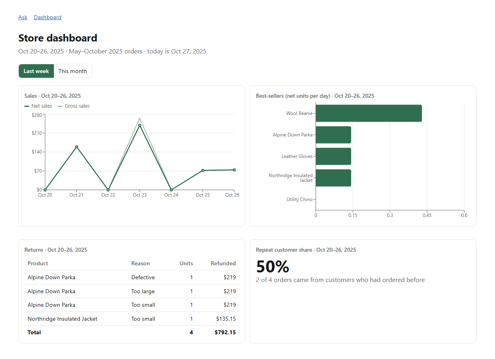

# Shopify merchant analytics chat (Zero University case project)

Merchants ask questions about their store in plain language ("jakets returnd last wk"). A model called through OpenRouter answers each question with **exactly one metric tool call over exact dates**. The answer streams back with a chart drawn from that tool's result.

The project is built on the Shopify order history for May to October 2025. Read **[NOTES.md](NOTES.md)** for the decisions behind it.

## Live

**Live on Vercel: https://shopifyforzero2.vercel.app**

| Page | Link |
|---|---|
| Dashboard | https://shopifyforzero2.vercel.app/dashboard |
| Ask a question | https://shopifyforzero2.vercel.app/chat |
| Metric API | https://shopifyforzero2.vercel.app/api/metrics |

The live run of Erik Vogt's acceptance questions is summarised below, under "Acceptance results (live)".

## Acceptance results (live)

I ran Erik Vogt's 20 acceptance questions against **https://shopifyforzero2.vercel.app** on Nov 22–23, 2026 (`npm run acceptance` with `BASE_URL` set to the live site). Model: `nvidia/nemotron-3.5-super-vl:free`. Store today: 2025-10-27.

| Threshold | Result | |
|---|---|---|
| ≥ 18 of 20 correct tool calls | **19 correct out of 19 answered.** AQ-08 is not yet re-run because of the daily limit. | **Met:** 19 ≥ 18 even if AQ-08 fails |
| 0 render crashes | **0** | **Met** |
| < 5.0 s to the first chart on every question | **Max 17.25 s.** AQ-14 took 17.25 s and AQ-04 took 5.16 s; the other 17 answered in 1.3–4.3 s. | **Not met** |

**What the first live run found, and what I fixed.** The first full run scored 17/20. It surfaced three real bugs, and I fixed each one and redeployed. The first run's report is kept in [reports/acceptance_first_run.md](reports/acceptance_first_run.md).
- **AQ-03: "jackets" matched one product instead of the category.** It filtered to the Northridge Insulated Jacket and missed the three parka returns. Generic words like jackets and coats now mean the Outerwear category.
- **AQ-02: the model wrote `<tool_call>` markup as text** instead of calling the tool. The server now hides that markup and retries once with the tool it named. It is still one tool call per question. Re-run live: correct, 2.86 s.
- **AQ-08: the model sent empty strings for "no date"** (`{"period":"","start":"","end":""}`), so validation rejected the call. Empty strings now mean "not given", so the team default range applies. A reply with no text now says so instead of going blank.
  - The re-run of AQ-08 hit the free daily limit (50 requests a day). It is the one question still to confirm live.

**Why two questions were slow.** Nemotron is a reasoning model: it streams its reasoning before it calls the tool, and on the free tier that time varies with OpenRouter's queue. The tool itself runs in milliseconds. I haven't changed the model settings to hit 5 s, because any change has to be checked live first.

**AQ-03, "which jackets came back the most last week".** A table titled **"Returns · Oct 20–26, 2025 · Outerwear"**, 4 units and $792.15 refunded:

| Product | Reason | Units | Refunded |
|---|---|---|---|
| Alpine Down Parka | Defective | 1 | $219.00 |
| Alpine Down Parka | Too large | 1 | $219.00 |
| Alpine Down Parka | Too small | 1 | $219.00 |
| Northridge Insulated Jacket | Too small | 1 | $135.15 |

**AQ-07, "what's my ad spend on Meta this month".** The model calls no tool and draws no chart. It says plainly that the store has no Meta ad spend or marketing cost data.

**Vague dates use the team default, Sep 27 – Oct 26, 2025, and the answer says so.** Examples:
- "refunds been bad lately?": 5 returned units, $920.94 refunded.
- "repeat customer share": 41.7%, 5 of 12 orders.

Every question's tool, arguments, dates and answer are in [reports/acceptance.md](reports/acceptance.md). Erik's sheet, filled in, is [reports/acceptance_results.xlsx](reports/acceptance_results.xlsx).



*`/dashboard`, last week (Oct 20–26, 2025). The `/chat` page draws the same charts under each answer.*

## Pages

| Page | What it shows |
|---|---|
| `/chat` | Merchants type a question. The answer streams in, and **under it the chart for that metric**, drawn from the tool's returned data. |
| `/dashboard` | All four metrics for **last week** or **this month**, with the same charts and no model involved. Needs no API key. |

## Setup

```bash
npm install
cp .env.example .env.local      # then paste your OpenRouter key into OPENROUTER_API_KEY
npm run dev                     # http://localhost:3000 (opens /dashboard); /chat to ask questions
```

Get a key at openrouter.ai → **Keys**. Create one for this project and give it a small credit limit. The default model is free, so the key costs nothing to use. Only the server reads the key, in `src/lib/chat.ts`. It isn't `NEXT_PUBLIC_`, so it never reaches the browser, and `.env.local` is git-ignored.

## Deployment (Vercel)

The repo is imported into Vercel as the project **shopifyforzero2**. Every push to `main` redeploys https://shopifyforzero2.vercel.app, and other branches get preview URLs.

**Environment variables.** These are set in Vercel → Project → Settings → Environment Variables, for Production and Preview:

| Variable | Value | Notes |
|---|---|---|
| `OPENROUTER_API_KEY` | the project's OpenRouter key | Stored encrypted in Vercel only, with a small credit cap. Never in the repo. |
| `STORE_TODAY` | `2025-10-27` | Fixed reference date: the end of the order data and the day the questions were sent. |
| `OPENROUTER_MODEL` | `nvidia/nemotron-3.5-super-vl:free` | Optional. Defaults to the same model. |

**How the key stays private on the live site**
- Only the server route `/api/chat` reads it, through `process.env`. It has no `NEXT_PUBLIC_` prefix, so it is never bundled into the browser.
- I checked that the live page source contains no key.
- Errors returned to the browser are rewritten into plain messages, so provider details never leak.

**The order data ships with the server functions.** `next.config.ts` includes `data/orders.csv` in the files Vercel bundles with each server function (`outputFileTracingIncludes`), so the live metrics read the real orders.

**Deployment Protection is off.** Reviewers can open the site without a Vercel login.

## Model choice

The default model is **`nvidia/nemotron-3.5-super-vl:free`** (NVIDIA Nemotron 3.5 Super, OpenRouter's free tier).

**Why this model**
- **The stage asks for a free OpenRouter model.** This keeps the project at zero cost.
- **It supports tool calling,** which the whole design depends on. Not every free model does.
- **It was the reliable free option when I tested.** I tried five free models that support tools with the same question, "jakets returnd last wk":
  - **Gemma 4 31B and Gemma 4 26B** (Google) were my first choice. Both were "temporarily rate-limited upstream" for every request. That limit is on Google's side, shared by everyone, not on our key.
  - **ERNIE 5.5 Flash** (Baidu) was also rate-limited upstream.
  - **Nemotron 3 Ultra** (NVIDIA) answered correctly but took about 17 seconds.
  - **Nemotron 3.5 Super** answered correctly in about 5 seconds: the right tool, Oct 20–26, Outerwear, and $792.15 refunded.
- **The model's job here is small.** It picks one of four tools, passes a period name or a date range, and writes a short answer. The server does the date rules and every calculation, so a free mid-size model is enough.

**Trade-offs**
- **Rate limits.** Free models are capped per minute and per day, so the 30-question check paces itself and can resume. See below.
- **Weaker on fuzzy date phrases** than a frontier model. The server-side date resolver and the one-call guard limit the damage. [reports/question-check.md](reports/question-check.md) shows how it actually did.

**Switching models** takes one line, with no code changes. For example, set `OPENROUTER_MODEL=google/gemma-4-31b-it:free` once Gemma's limit clears, or `OPENROUTER_MODEL=anthropic/claude-sonnet-5.5` (paid) in `.env.local`. The tools, the prompt and the guard are the same for every model.

## Chart choices

Each metric gets the chart shape that fits the question it answers.

| Metric | Chart | Why |
|---|---|---|
| Sales by day | **Line** | It's a trend over time. Merchants want to see the Black Friday ramp or a slowdown. Days with no orders plot as zero, so gaps are honest. Weekly or monthly views use the same line with fewer points. |
| Product velocity | **Bar** (horizontal, ranked) | "What sells best / what do I reorder" compares products, and the longest bar answers it at a glance. Bars are sorted by **net units per day**. A product that sells well but mostly comes back, like the Alpine Down Parka (4 sold, 3 returned), doesn't look like a winner. |
| Returns by product and reason | **Table** | Each row combines a product, a reason, units and refunded dollars, which suits a table the merchant can scan and act on. Last week it was four rows of Outerwear: 3 Alpine Down Parkas (defective, too large, too small) and 1 Northridge Insulated Jacket (too small). That makes the sizing problem obvious. |
| Repeat customer share | **Metrics card** | One number with its context, e.g. **50% — 2 of 4 orders**. The count stays on the card because order volumes are small, and a percentage alone would overstate a swing. A "by month" or "is it growing" question shows the same metric as a small line. |

### How charts are drawn

- **The data comes from the tool result, not the model.** The model writes the sentence. The chart is built (`src/lib/chartSpec.ts`) from exactly what the metric function returned, so the picture and the numbers can't disagree.
- **The chart is picked by tool name.** Every chart title carries the exact dates and filter, e.g. "Returns · Oct 20–26, 2025 · Outerwear".
- **No chart for errors.** If the tool returned an error, or no tool was called (ad spend, last year), the answer is text only.
- **No empty charts.** A range with no orders shows "No orders in this range" (or "No returns in this range").
- **Straight lines** connect the daily sales points, so the chart doesn't suggest sales between days.

## Loading state

The loading state is driven by each tool part's streaming state from `useChat`, not by timers (`src/lib/loadingState.ts`). It goes through these stages:

| Stage | Merchant sees |
|---|---|
| Question sent, no tool picked yet (`submitted`) | "Reading your question…" |
| Tool chosen, running (`input-streaming` / `input-available`) | A **skeleton in the shape of the coming chart**: a grey line, bars, table rows or a card. The caption fills in once the dates arrive, e.g. "Checking returns for Oct 20–26, 2025 · Outerwear…". |
| Result arrives (`output-available`) | The real chart **in the same spot and at the same size**, so the page doesn't jump. |
| Error (`output-error`) or no tool | The skeleton is removed and only the text answer shows. |

**Other details**
- While an answer runs, **Ask** turns into **Stop** (which calls `stop()`), and the example buttons are disabled.
- Skeletons stop pulsing for users who prefer reduced motion.
- Each skeleton carries a "Loading" status for screen readers.

## Commands

| Command | What it does |
|---|---|
| `npm test` | Tests the metrics, the date rule, the tools, the one-call guard, chart selection, loading states and the chat stream with a mock model (56 tests). Needs no key. |
| `npm run check:questions` | Runs all 30 merchant questions through the real model and writes **[reports/question-check.md](reports/question-check.md)**: the tool, dates and filter for each question, plus pass/fail spot checks. Needs the key. If it stops on the free model's rate limit, run it again and it resumes. |
| `npm run acceptance` | Runs Erik Vogt's 20 acceptance questions against `BASE_URL` (the live site, or localhost) and writes `reports/acceptance.md` and `reports/acceptance_results.xlsx`. It resumes if the free limit stops it. |
| `npm run build` | Production build. |

## How it works

### The four metrics

These are in `src/lib/metrics.ts`:

1. **Sales by day:** counted on the order date. Can be grouped by week or month.
2. **Product velocity:** net units sold per day.
3. **Returns by product and reason:** counted on the **return date**.
4. **Repeat customer share:** the share of orders from customers who had ordered before. Can be grouped by week or month.

### The tools

The tools are in `src/lib/chat.ts`. Each description uses the words merchants actually typed in `data/merchant_questions.json`.

- **"Came back" goes to the right tool.** Products that came back are returns. People who came back are repeat customers.
- **Category words are mapped.** Jackets, coats, parkas and puffers all mean the Outerwear category.

### Exact dates

- **The server owns the dates.**
  - The model passes `period: "last_week" | "this_month"`, and the server turns it into exact dates with the tested `resolvePeriod`.
  - For any other phrase the model passes an explicit `start` and `end`, using date anchors given in the system prompt.
- **Every tool result echoes the dates it used,** and every answer starts with them.
- **Ranges outside the data are rejected.** The order history covers 2025-05-01 to today, and the model relays the error.

### One question, one tool call

Three layers enforce it:

1. Parallel tool calls are off.
2. The chat route allows at most 2 steps. Step 2 has tools switched off, so it can only answer.
3. The tool guard refuses any second call in the same request.

### No data, no tool

Some questions ask about ad spend, ROAS, inventory or dates before May 2025. The model says the data is missing instead of guessing.

## Layout

- `data/orders.csv`: the order export, one row per line item
- `data/merchant_report_requests_oct27.xlsx` and `data/merchant_questions.json`: the 30 merchant questions
- `src/lib/orders.ts`, `dates.ts`, `metrics.ts`: the loader, the date rule and the four metrics
- `src/lib/chat.ts`: the tools, the system prompt and the model settings
- `src/app/api/chat/route.ts`: the streaming chat route
- `src/app/chat/`: the chat UI, with a chart and loading state for each answer
- `src/app/dashboard/page.tsx`: all four charts for last week or this month
- `src/components/Charts.tsx`: line, bar, table, card and skeleton components (Recharts)
- `src/lib/chartSpec.ts`, `src/lib/loadingState.ts`: picks the chart from a tool result and the loading view from a tool state
- `docs/dashboard.png`: the README screenshot
- `src/app/api/metrics/route.ts`: the metrics as plain JSON, with no model
- `src/lib/chatStream.ts`: the chat answer stream, with the markup retry and no-blank fallback
- `scripts/check-questions.ts`: the 30-question check
- `scripts/acceptance.ts`: Erik's acceptance run

